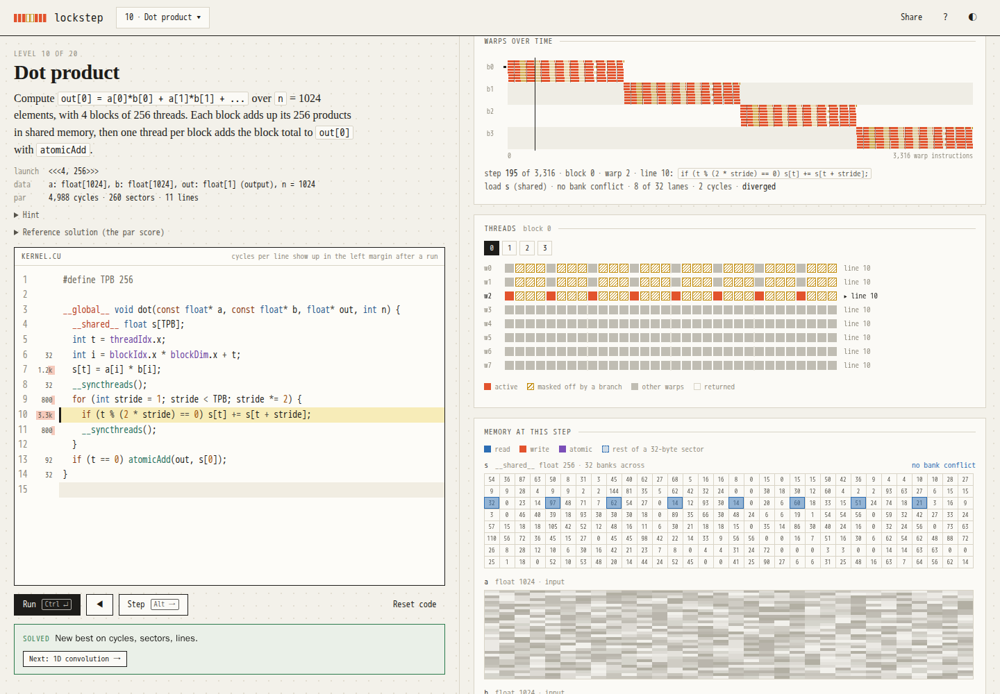

# lockstep



A browser game for learning GPU programming. You write small CUDA kernels and a simulated GPU runs them warp by warp, in lockstep, showing every thread, every memory access and what it costs.

Play it at [mottopanikeiku.github.io/lockstep](https://mottopanikeiku.github.io/lockstep/). It is a static page; your code and progress stay in the browser.

## How to play

Each level gives you a task, a launch configuration and a kernel signature. Write the kernel and press Run (Ctrl+Enter). If the output is right you get three scores against par. Then step through the run (Alt+→), drag across the timeline, click a lane to see its variables, and look for where the cycles went: the margin of the editor shows them per line.

Kernels are written in a subset of CUDA C with nothing added on top: `__global__`, `int`/`float`/`bool`, `__shared__` arrays, loops and branches, `threadIdx` and friends, `__syncthreads()`, `atomicAdd`, `__shfl_down_sync`/`__shfl_xor_sync`, `expf`, `fmaxf` and a few more. The Share button puts your solution in the URL.

## Levels

| | |
|---|---|
| Basics | map, zip, guard, map 2D, broadcast, blocks, blocks 2D |
| Shared memory | neighbours, pooling, dot product, 1D convolution, prefix sum, axis sum |
| Bigger kernels | matmul, tiled matmul, transpose, warp shuffle reduction, histogram, softmax, flash attention |

The first three open in order, then you can play any of them.

## Scoring

Par comes from a reference solution for each level.

- cycles: the total over all warps. An instruction costs 1, a global access 4 more per 32-byte sector it touches, a shared access 1 more per bank wavefront, and a warp waiting at `__syncthreads()` keeps counting.
- sectors: 32-byte pieces of global memory moved.
- lines: lines of code.

The model is small on purpose and does not predict real GPU time. [docs/cost-model.md](docs/cost-model.md) has all of it on one page. Divergent branches really run both sides, so they show up in cycles. The simulator also stops a run at out-of-bounds accesses, data races (shared and global, reported the way compute-sanitizer's racecheck does) and barriers that would hang a real GPU.

## Run locally

```
npm ci
npm run dev      # http://localhost:5173/lockstep/
npm test         # parser, simulator, and every level's reference solution
npm run smoke    # builds, then solves level 1 in headless Chromium
```

The parser, the IR with its post-dominator analysis, and the warp simulator are in `src/lang`, `src/ir` and `src/sim`. No dependencies beyond CodeMirror for the editor.

Inspired by Sasha Rush's [GPU-Puzzles](https://github.com/srush/GPU-Puzzles).

MIT license.
