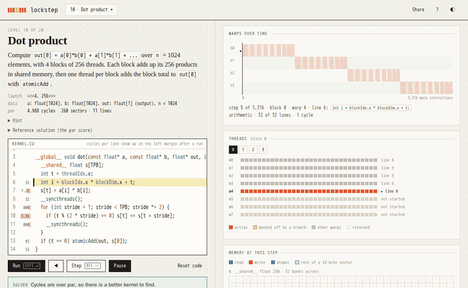

# lockstep



lockstep is a browser game for learning GPU programming, in which you write small CUDA kernels and a simulated GPU runs them warp by warp, showing every thread, every memory access and what each one costs. You can play it at [mottopanikeiku.github.io/lockstep](https://mottopanikeiku.github.io/lockstep/), which is a static page that keeps your code and progress in the browser.

## How to play

Each level gives you a task, a launch configuration and a kernel signature, and when you press Run (Ctrl+Enter) with a correct kernel you get three scores against par. You can then play the run back or step through it with Alt+→, click a lane to see its variables, and read the editor margin to see which lines the cycles went to, while the Share button puts your solution in the URL for someone else to run.

Kernels are written in a subset of CUDA C with nothing added on top, covering `__global__`, `int`/`float`/`bool`, `__shared__` arrays, loops and branches, `threadIdx` and friends (unsigned, as in CUDA), `__syncthreads()`, `atomicAdd`, `__shfl_down_sync`/`__shfl_xor_sync`, `expf`, `fmaxf` and a few more. Every level's starter code and reference solution compiles unchanged with nvcc 13.4, which CI checks on each push by putting each kernel in a file with a host function that launches it the way the game does.

## Levels

| | |
|---|---|
| Basics | map, zip, guard, map 2D, broadcast, blocks, blocks 2D |
| Shared memory | neighbours, pooling, dot product, 1D convolution, prefix sum, axis sum |
| Bigger kernels | matmul, tiled matmul, transpose, warp shuffle reduction, histogram, softmax, flash attention |

The first three open in order, and after that you can play any of them.

## Scoring

Par is the score of each level's reference solution, and the three scores are:

- cycles, the total over all warps, where an instruction costs 1, a global access 4 more per 32-byte sector it touches, a shared access 1 more per bank wavefront, and a warp waiting at `__syncthreads()` keeps counting
- sectors, the 32-byte pieces of global memory moved
- lines, the lines of code

The model is small on purpose and does not predict real GPU time, and [docs/cost-model.md](docs/cost-model.md) has all of it on one page. Divergent branches really run both sides, so they show up in cycles, and the simulator stops a run at out-of-bounds accesses, at data races in shared or global memory (judged the way compute-sanitizer's racecheck judges shared memory) and at barriers that not every thread of the block reaches.

## Run locally

```
npm ci
npm run dev      # http://localhost:5173/lockstep/
npm test         # parser, simulator, and every level's reference solution
npm run smoke    # builds, then solves and plays level 1 in headless Chromium
npm run nvcc     # compiles every level's kernels, if nvcc is on your PATH
```

The smoke test needs `npx playwright install chromium` once. The parser, the IR with its post-dominator analysis and the warp simulator live in `src/lang`, `src/ir` and `src/sim`, and the only runtime dependency is CodeMirror for the editor.

lockstep was inspired by Sasha Rush's [GPU-Puzzles](https://github.com/srush/GPU-Puzzles), which teaches the same ideas through Numba in a notebook. It is released under the MIT license.
